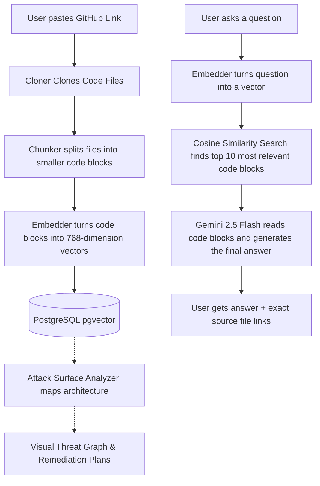

# RepoLens

RepoLens is an AI-powered codebase intelligence and security assistant. It helps you instantly understand any code repository by importing it, breaking the files into smart chunks, storing them in a database using AI vectors, and letting you ask questions in natural language. Additionally, it features an Attack Surface Analyzer that visually maps potential vulnerabilities across your infrastructure.

RepoLens provides exact answers, citing exactly which files and lines of code were used to find the answer.


---

## Features

- **Smart Repository Importer**: Accepts public GitHub links and downloads them using a hybrid cloning strategy (Git clone with GitHub Tarball API fallback).
- **Code File Filter & Smart Chunking**: Targets source-code files (`.ts`, `.tsx`, `.js`, `.jsx`, `.md`, `.json`) while filtering out bulky dependencies and locks. Splits large files into logical blocks to preserve context structure.
- **Semantic Search (pgvector)**: Uses PostgreSQL's vector extension to run fast cosine similarity searches across your codebase.
- **AI Chat with Citations**: Ask how a feature is built, where a bug might be, or how modules connect. Gemini 2.5 Flash generates responses cited with source file references.
- **Rate-Limit & Backoff Protection**: Automatically handles rate-limit headers and pauses index operations using exponential backoff to handle large repositories smoothly.
- **Attack Surface Analyzer**: An interactive, node-based visual graph (powered by React Flow) that maps out your architecture's potential threat vectors, gateways, and critical data stores to help you generate instant remediation plans.

---

## Tech Stack

- **Framework**: [Next.js](https://nextjs.org/) & [React](https://react.dev/)
- **Database**: [PostgreSQL](https://www.postgresql.org/) with the `pgvector` extension
- **ORM**: [Prisma](https://www.prisma.io/) (utilizing PostgreSQL Extensions preview feature)
- **AI Models**:
  - `models/gemini-embedding-2` (for creating 768-dimensional code search vectors)
  - `gemini-2.5-flash` (for understanding code context and answering questions)
- **Visuals & Graphs**: [@xyflow/react](https://reactflow.dev/) (for interactive threat modeling)
- **Styling**: [Tailwind CSS v4](https://tailwindcss.com/)
- **Icons**: [Lucide React](https://lucide.dev/) & Material Symbols

---

## Setup & Installation

Follow these steps to run RepoLens locally:

### 1. Prerequisites
- **Node.js** (v18 or higher recommended)
- **npm** or your preferred package manager (yarn, pnpm, bun)
- A **PostgreSQL Database** with the `pgvector` extension enabled (e.g. [Supabase](https://supabase.com/))

### 2. Configure Environment Variables
Create a file named `.env.local` in the root of your project directory and add the following keys:

```env
# Connection string for your PostgreSQL database (with pgvector support)
DATABASE_URL="your-postgresql-connection-string"

# Direct connection string (required by Prisma for migrations if using a connection pooler)
DIRECT_URL="your-direct-postgresql-connection-string"

# Your Google Gemini API Key
GEMINI_API_KEY="your-gemini-api-key"
```

> [!TIP]
> If you are using Supabase, make sure your database URL has `?pgbouncer=true` if using a pooler connection, and your `DIRECT_URL` points directly to port 5432. E.g., see the `.env.local` example.

### 3. Install Dependencies
Install all the required packages:

```bash
npm install
```

### 4. Setup the Database Schema
Sync the database with the Prisma schema and enable the PostgreSQL vector extension:

```bash
# Generate the Prisma client
npx prisma generate

# Push the schema structure to your database
npx prisma db push
```

### 5. Start the Development Server
Run the application locally:

```bash
npm run dev
```

Open [http://localhost:3000](http://localhost:3000) in your browser to see the app!

---

## How It Works (The Intelligence Flow)

Here is a high-level look at what happens behind the scenes:



### 1. Hybrid Cloning & Storing
When you input a GitHub repository URL:
- RepoLens checks the repo size via the GitHub API to ensure it is under 200MB.
- It attempts to perform a shallow clone (`git clone --depth 1`) in a temporary directory.
- **Fallback Strategy**: If `git clone` fails, it falls back to downloading and extracting the repository's tarball from the GitHub API using `tar`.
- Only targeted code files (`.ts`, `.tsx`, `.js`, `.jsx`, `.md`, `.json`) are parsed; dependency folders (like `node_modules` or `.next`) and lockfiles are skipped.
- Files are stored in the database in batches of 1,000 to respect PostgreSQL query parameter constraints.

### 2. Chunking & Embedding
To search through your code semantic-by-semantic:
- The system breaks down the file contents into smaller, logical blocks (under 1,500 tokens).
- Code chunks are sent to the Gemini API (`gemini-embedding-2`) in batches of 100.
- If a rate limit (429) is encountered, the embedder automatically retries using exponential backoff.
- The generated **768-dimensional numerical vectors** are written into the database using Prisma's raw SQL execution as a `::vector` type.

### 3. Smart Code Searching & Answering
When you ask a question (e.g. *"How does the authentication flow work?"*):
- RepoLens converts your question into a matching vector.
- It performs a **Cosine Similarity Search** using PostgreSQL's `<=>` operator.
- It quickly fetches the **top 10 most similar code blocks** relevant to your question.
- It feeds these 10 code blocks into **Gemini 2.5 Flash**, which reads them, synthesizes a response, and cites the exact paths where the code lives.

### 4. Interactive Threat Modeling
Using `@xyflow/react`, RepoLens visually interprets the extracted system architecture:
- Renders an **Attack Vector Graph** showcasing Gateways, APIs, and Data stores.
- Highlights paths and potential vulnerabilities to assist in generating rapid remediation plans.

---

## Troubleshooting

- **429 Rate Limit Errors**: If you import a repository with hundreds of files, you might hit Gemini API limits. RepoLens includes an automated retry system with exponential backoff to pause and continue indexing without failing.
- **Database Vector Errors**: Ensure that your PostgreSQL database has `pgvector` installed and enabled. If you use Supabase, the extension is enabled automatically through the `schema.prisma` file configuration.
