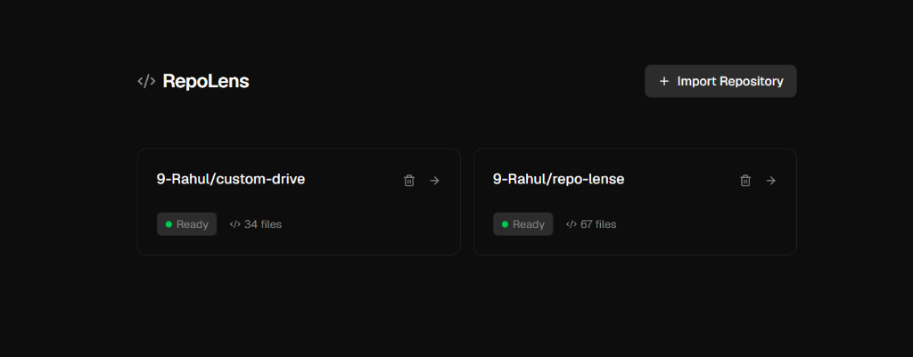
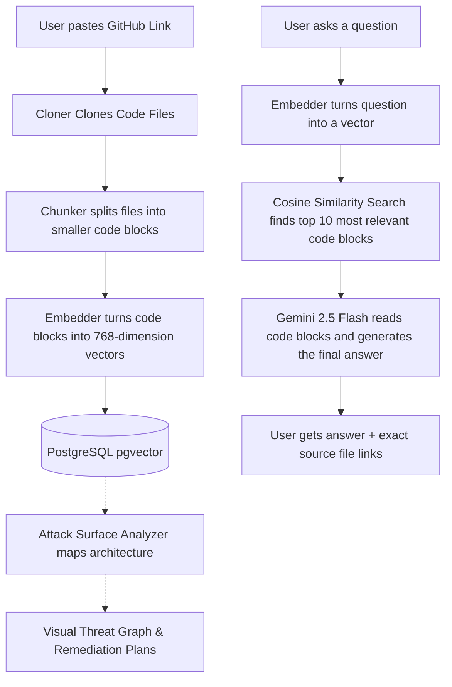

# 🔍 RepoLens

RepoLens is an AI-powered codebase intelligence and security assistant. It helps you instantly understand any code repository by importing it, breaking the files into smart chunks, storing them in a database using AI vectors, and letting you ask questions in natural language. Additionally, it now features an **Attack Surface Analyzer** that visually maps potential vulnerabilities across your infrastructure.

RepoLens gives you exact answers and tells you **exactly which files and lines of code** it used to find the answer.



---

## ✨ Features

- **📂 Import Any GitHub Repository**: Paste a public GitHub link (up to 200MB) to download and store its code files instantly.
- **🧠 Smart Code Chunking**: Splits large files into smaller, logical blocks of code to keep context clean and clear.
- **⚡ Supercharged Search (pgvector)**: Uses PostgreSQL's vector extension to run incredibly fast, semantic search across your entire codebase.
- **💬 AI Chat with Citations**: Ask how a feature is built, where a bug might be, or how modules connect. You receive an answer from Google Gemini, accompanied by a list of source files used as context.
- **🛡️ Rate-Limit Protection**: Smart retry logic with exponential backoff guarantees that the AI won't break or error out due to rate limits during large imports.
- **🎯 Attack Surface Analyzer (NEW)**: An interactive, node-based visual graph (powered by React Flow) that maps out your architecture's potential threat vectors, gateways, and critical data stores to help you generate instant remediation plans.

---

## 🛠️ Tech Stack

- **Framework**: [Next.js](https://nextjs.org/) (App Router) & [React](https://react.dev/)
- **Database**: [PostgreSQL](https://www.postgresql.org/) with the `pgvector` extension
- **ORM**: [Prisma](https://www.prisma.io/)
- **AI Models**:
  - `models/gemini-embedding-2` (for creating code search vectors)
  - `gemini-2.5-flash` (for understanding the code and answering questions)
- **Visuals & Graphs**: [@xyflow/react](https://reactflow.dev/) (for interactive threat modeling)
- **Styling**: [Tailwind CSS v4](https://tailwindcss.com/)
- **Icons**: [Lucide React](https://lucide.dev/) & Material Symbols

---

## 🚀 Setup & Installation

Follow these steps to run RepoLens locally on your computer:

### 1. Prerequisites
- **Node.js** (v18 or higher recommended)
- **npm** or your favorite package manager (yarn, pnpm, bun)
- A **PostgreSQL Database** with the `pgvector` extension enabled (You can get a free one in 1 minute on [Supabase](https://supabase.com/))

---

### 2. Configure Environment Variables
Create a file named `.env.local` in the root of your project directory and add the following keys:

```env
# Connection string for your PostgreSQL database (with pgvector support)
DATABASE_URL="your-postgresql-connection-string"

# Direct connection string (required by Prisma for migrations if using a pooler)
DIRECT_URL="your-direct-postgresql-connection-string"

# Your Google Gemini API Key
GEMINI_API_KEY="your-gemini-api-key"
```

> [!TIP]
> If you are using Supabase, make sure your database URL has `?pgbouncer=true` if using a pooler connection, and your `DIRECT_URL` points directly to port 5432. E.g., see the `.env.local` example.

---

### 3. Install Dependencies
Install all the required packages:

```bash
npm install
```

---

### 4. Setup the Database Schema
Sync the database with the Prisma schema and enable the PostgreSQL vector extension:

```bash
# Generate the Prisma client
npx prisma generate

# Push the schema structure to your database
npx prisma db push
```

---

### 5. Start the Development Server
Run the application locally:

```bash
npm run dev
```

Open [http://localhost:3000](http://localhost:3000) in your browser to see the app!

---

## 🧩 How It Works (The Intelligence Flow)

Here is a high-level look at what happens behind the scenes:



### 1. Cloning & Storing
When you input a GitHub repository URL:
- RepoLens checks the repo size via the GitHub API to ensure it is under 200MB.
- It clones the codebase and parses all key code files (`.ts`, `.tsx`, `.js`, `.py`, etc.).
- It saves these files to your database under the `File` model.

### 2. Chunking & Embedding
To search through your code semantic-by-semantic:
- The system breaks down the file contents into smaller, logical blocks called `Chunks` (around 1,500 tokens maximum).
- Each code chunk is sent to the Gemini API (`gemini-embedding-2`), which generates a **768-dimensional numerical vector** representing its meaning.
- The chunk and its vector are saved inside the PostgreSQL `Chunk` table.

### 3. Smart Code Searching & Answering
When you ask a question (e.g. *"How does the authentication flow work?"*):
- RepoLens converts your question into a matching vector.
- It performs a **Cosine Similarity Search** (using the `pgvector` `<=>` operator) in your database.
- It quickly fetches the **top 10 most similar code blocks** that are highly relevant to your question.
- It feeds these 10 code blocks into **Gemini 2.5 Flash**, which reads them, synthesizes a clear response, and cites the exact files where the code lives.

### 4. Interactive Threat Modeling
Using the `@xyflow/react` library, RepoLens now visually interprets the extracted system architecture:
- Renders an **Attack Vector Graph** showcasing Gateways, APIs, and Data stores.
- Highlights paths and potential vulnerabilities to assist in generating rapid remediation plans.

---

## 💡 Troubleshooting

- **429 Rate Limit Errors**: If you import a repository with hundreds of files, you might hit Gemini API limits. RepoLens includes an automated, smart retry system (using exponential backoff) to pause and continue indexing without failing.
- **Database Vector Errors**: Ensure that your PostgreSQL database has `pgvector` installed and enabled. If you use Supabase, the extension is enabled automatically through the `schema.prisma` file configuration.
